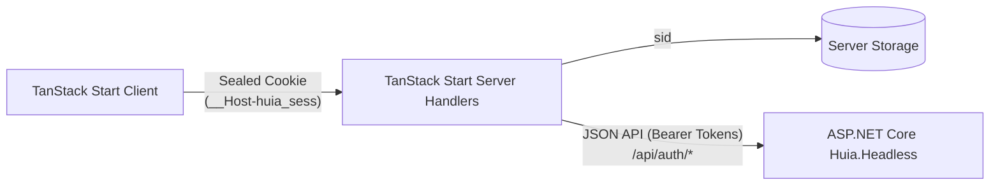

# `@huia/tanstack-start-headless` — Overview

`@huia/tanstack-start-headless` is the official **TanStack Start** client library for interacting with `Huia.Headless` ASP.NET Core backends. Designed for applications that own their user interfaces completely, it provides password login, self-registration, phone SMS one-time passcode verification, and external broker flows over pure JSON APIs without OIDC redirects or hosted identity forms.

- Package: `@huia/tanstack-start-headless`
- Built on [`huia-auth-core`](/core/overview)
- Compatible with TanStack Start & TanStack Router (v1.169+)

## Key Features

- **No hosted login screens**: Your TanStack Start application renders all registration, password, SMS OTP, and profile forms.
- **Sealed cookie layer**: Transparently handles tokens behind the scenes. Server route handlers convert JSON token responses into sealed `__Host-huia_sess` cookies via `iron-webcrypto`.
- **Phone SMS one-time passcodes**: Complete three-stage flow: start with phone number, verify code, and complete optional profile (first/last name).
- **External identity providers**: Initiate external broker redirects and complete user profile callbacks.
- **TanStack Router integration**: Server session reading via `getHuiaHeadlessSession()`, server functions via `createHuiaHeadlessServerFns()`, and client state via `<HuiaHeadlessProvider>`, `useHuia()`, and `useUserSession()`.
- **Zero-config Vite plugin**: Bundles `huiaHeadless()` Vite plugin for scaffolding missing server route handlers.

## Architecture

## Available Subpaths

- `@huia/tanstack-start-headless`: Main entry point re-exporting client and server utilities.
- `@huia/tanstack-start-headless/server`: Server-side Route Handler factory (`createHuiaHeadlessHandler`), session helpers (`getHuiaHeadlessSession`, `getAccessToken`), server functions (`createHuiaHeadlessServerFns`), and route middleware.
- `@huia/tanstack-start-headless/client`: Client-side React context provider (`HuiaHeadlessProvider`), hooks (`useHuia`, `useUserSession`), and context.
- `@huia/tanstack-start-headless/vite`: Vite plugin (`huiaHeadless`) for route scaffolding.
