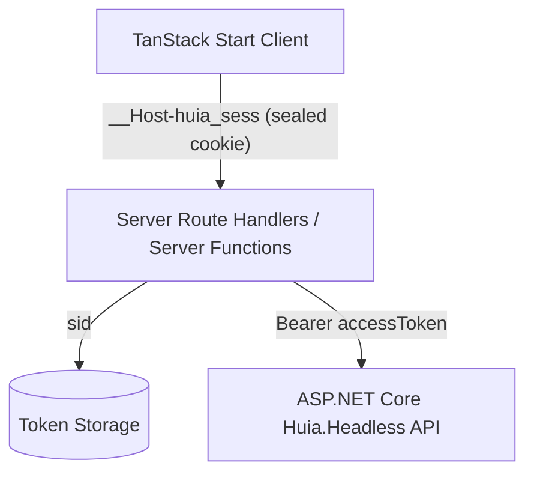

# `@huia/tanstack-start-headless` — Session Model & Security

`@huia/tanstack-start-headless` bridges the pure JSON token model of `Huia.Headless` with the secure SSR cookie model expected by modern full-stack web frameworks.

## Dual-Layer Token Architecture

1. **Client Layer**: The browser only ever sees an `iron-webcrypto` sealed session cookie containing the session ID (`sid`) and sanitized user claims.
2. **Server Layer**: Raw bearer tokens (`accessToken`, `refreshToken`) are held securely on the server (in memory, Redis, or stateful storage).
3. **Stateless Option**: If `session.stateless = true`, the entire encrypted token record is packed into chunked AES-GCM cookies with zero server-side storage required.

## Transparent Token Refresh

Whenever `getAccessToken(config, request)` or `getHeadlessAccessToken(config, request)` is invoked server-side:

1. The token record is checked against `accessTokenExpiresAt`.
2. If the token is near expiration, the refresh token is exchanged with the `Huia.Headless` `/refresh` endpoint automatically.
3. The renewed access token is saved in storage and returned to the caller.
