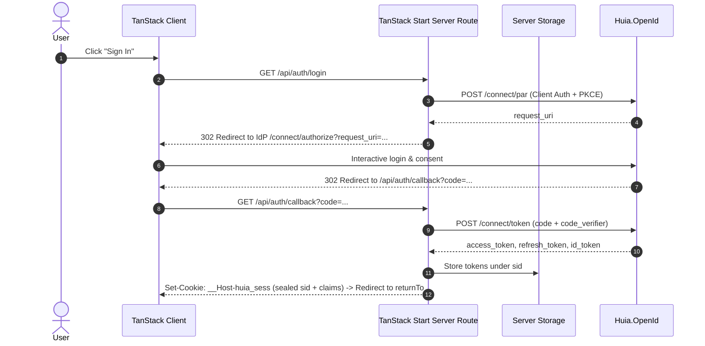

# `@huia/tanstack-start-oidc` — Overview

`@huia/tanstack-start-oidc` is the official **TanStack Start** integration library for signing a relying-party application into a `Huia.OpenId` tenant. It executes the OAuth 2.0 Authorization Code Flow with PKCE and Pushed Authorization Requests (RFC 9126 PAR) on **TanStack Start Server Handlers / Server Functions**, keeping tokens secure on the server.

- Package: `@huia/tanstack-start-oidc`
- Compatible with TanStack Start & TanStack Router (v1.169+)
- Core engine: [`huia-auth-core`](/core/overview) and [`openid-client`](https://github.com/panva/openid-client) v6

## Key Features

- **Dual-layer session security**: The browser only receives an encrypted, chunked `__Host-huia_sess` cookie (`iron-webcrypto`) containing an opaque session identifier and safe claims. Raw access, refresh, and ID tokens are stored in server-side storage.
- **Pushed Authorization Requests (PAR)**: Authorization parameters are securely pushed via backchannel to Huia's `/{tenant}/connect/par` endpoint, exposing only a transient `request_uri` in the browser.
- **Transparent token refresh**: Server-side helpers automatically refresh access tokens when nearing expiration using a single-flight mutex.
- **TanStack Router integration**: Seamlessly works with `beforeLoad` route protection (`requireHuiaAuth`), server functions (`createServerFn`), server route handlers, and React `<HuiaOidcProvider>` with `useUserSession()`.
- **Zero-config Vite plugin**: Bundles `huiaOidc()` Vite plugin that automatically scaffolds missing catch-all auth routes (`api/auth/$`).

## Flow Diagram

## Available Subpaths

- `@huia/tanstack-start-oidc`: Main entry point re-exporting client and server utilities.
- `@huia/tanstack-start-oidc/server`: Server-side Route Handler factory (`createHuiaOidcHandler`), session inspectors (`getHuiaSession`, `getAccessToken`), server functions (`createHuiaServerFns`), and route middleware (`requireHuiaAuth`).
- `@huia/tanstack-start-oidc/client`: Client-side React context provider (`HuiaOidcProvider`), hook (`useUserSession`), and user context.
- `@huia/tanstack-start-oidc/vite`: Vite plugin (`huiaOidc`) for route scaffolding.
